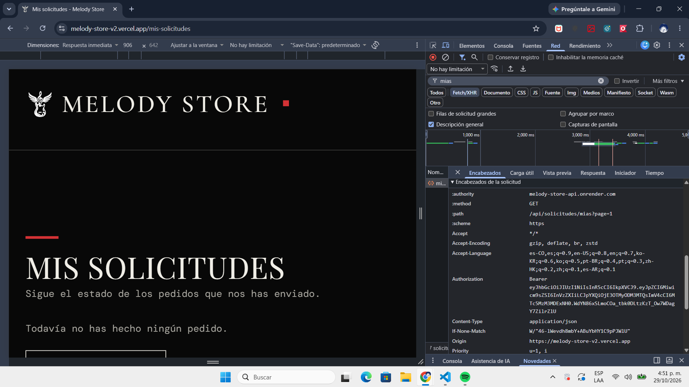

# Melody Store

Este es el frontend de mi tienda de instrumentos musicales, la Entrega 3 de Desarrollo Web. Pasé mi sitio de la Entrega 1, que estaba hecho con HTML, CSS y JS, a Next.js. Mantuve los textos, las imágenes y el estilo negro y rojo que ya tenía.

- Sitio: https://melody-store-v2.vercel.app
- API: https://melody-store-api.onrender.com
- Backend: https://github.com/Juls95A/melody-store-api

## Qué usé

Next.js (App Router), TypeScript y Tailwind.

## Cómo está organizado

En `app/` están las páginas, y cada una solo arma la vista con componentes. La lógica está en `src/features`, separada en `common`, `auth`, `productos` y `solicitudes`. Cada feature tiene sus componentes, hooks, services y tipos. Decidí que ningún componente use `fetch` directo: todo pasa por `http.ts`, después por los services y por último por los hooks.

## Qué se puede hacer

Se puede ver el catálogo por categorías, con paginación y filtros, y agregar productos a la canasta. Desde la canasta se hace el pedido con dirección de envío y método de pago, y después se puede ver en Mis solicitudes. El admin puede crear, editar y eliminar productos, y cambiar el estado de los pedidos.

## Páginas

| Ruta | Quién puede entrar |
| --- | --- |
| `/` | Todos |
| `/instrumentos` | Todos |
| `/accesorios` | Todos |
| `/nosotros` | Todos |
| `/contacto` | Todos |
| `/canasta` | Todos (para hacer el pedido hay que iniciar sesión) |
| `/login` | Solo sin sesión |
| `/registro` | Solo sin sesión |
| `/mis-solicitudes` | Usuarios con sesión |
| `/admin` | Solo admin |

## Correrlo en local

```bash
npm install
echo "NEXT_PUBLIC_API_HOST=http://localhost:4000" > .env.local
npm run dev
```

El backend tiene que estar corriendo en el puerto 4000 para que funcione.

## Usuarios de prueba

- Admin: `admin@melodystore.com` / `Admin123*`
- Usuario: `user@melodystore.com` / `User123*`

Estos usuarios son solo para la entrega.

## Despliegue

Lo subí a Vercel con auto-deploy desde `main`. En Vercel configuré `NEXT_PUBLIC_API_HOST` apuntando a la API en Render.

## Decisiones técnicas

### Flujo de un login

### Dónde guardo el token y qué riesgo tiene

### Cuándo responde 401 y cuándo 403

### Uso de IA

## Captura de Network


